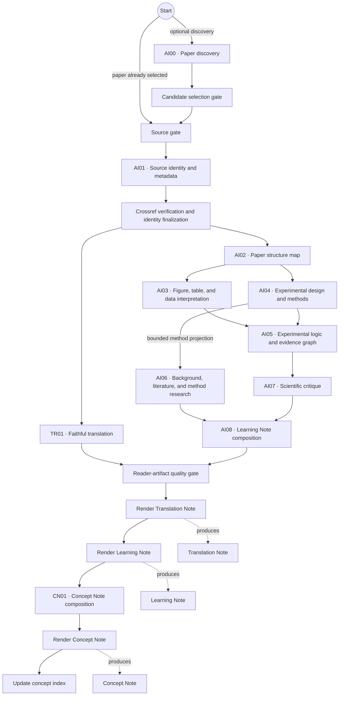
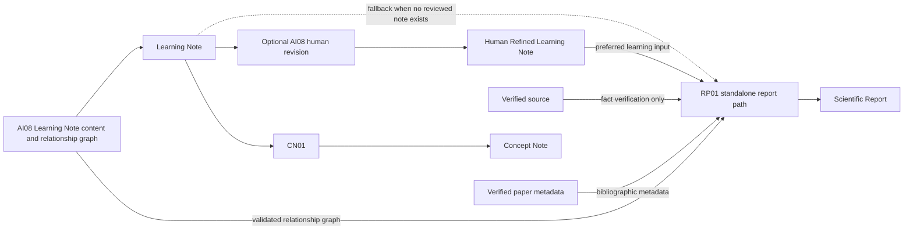

# InsightLab Workflow

## Purpose

InsightLab turns a verified scientific paper into several reader-facing study
artifacts while preserving the distinction between source facts, analysis,
external literature, criticism, and human revision.

The production workflow uses LangGraph for the core paper-analysis graph.
Translation runs as an isolated branch, and human revision and scientific
report writing are explicit post-processing paths rather than hidden graph
steps.

## Workflow Diagram



The diagram shows the production graph's main data flow. Validation,
checkpoint persistence, rejected-response preservation, and deterministic
assembly happen around each specialist stage but are not expanded into
separate diagram nodes.

## Agent Roles

| Stage | Role | Main input | Main output |
|---|---|---|---|
| AI00 | Optionally discovers and ranks candidate papers | Discovery request and external metadata | Candidate set |
| AI01 | Verifies the supplied paper and establishes its identity and bibliographic metadata | Primary source and optional selection metadata | Verified source record |
| TR01 | Translates the complete ordered source without summarizing it | AI01-verified logical source segments | Translation result |
| AI02 | Maps sections, methods, results, figures, tables, and source locations | Verified paper | Paper map |
| AI03 | Interprets reported data and visual evidence | Source plus AI02 data-navigation view | Data interpretation |
| AI04 | Reconstructs the performed experimental design and major methods | Source plus AI02 methods-navigation view | Methods and design analysis |
| AI05 | Connects experiments, results, claims, dependencies, and relationship evidence | AI03 and AI04, with direct source verification where contracted | Evidence logic and relationship graph |
| AI06 | Researches publication context, later literature, and the principles and limits of major methods | AI02 orientation plus a bounded AI04 method projection | Literature and methodology research |
| AI07 | Evaluates evidential strength, interpretation boundaries, and visual relevance | AI05 plus verified visual candidates | Scientific critique |
| AI08 | Integrates verified methods, literature, critique, and approved visuals into a Learning Note | AI04, AI06, AI07, minimal paper identity, and approved visual catalog | Learning Note content and reader relationship views |
| CN01 | Turns selected Learning Note concepts into a reusable paper-linked Concept Note | Validated AI08 content | Concept Note content |
| RP01 | Builds a professional final study report after Learning Note review | Preferred HRLN or LN, source, verified metadata, and AI08 relationship graph | Scientific Report |

## Core Dependency Rules

- AI00 is optional. AI01 is the common verified-source entry point.
- TR01 is isolated from scientific analysis and never feeds AI02 through AI08.
- AI03 and AI04 branch after AI02.
- AI06 begins only after AI04 and receives a compact, bounded projection of
  the major methods that were actually performed. It does not receive the full
  AI04 result or the internal evidence-analysis branch.
- AI05 begins only after both AI03 and AI04 are available.
- AI07 follows AI05 and does not consume AI06.
- AI08 is the first merge of the literature branch and internal-analysis
  branch: AI06 and AI07 must both be available.
- Immutable upstream claims, findings, identifiers, source references, and
  exact locators are assembled deterministically rather than rewritten by a
  provider.
- Every persisted upstream result must match the active `paper_id`, `run_id`,
  and explicit result reference. A global latest-result fallback is not a
  production dependency.

## Translation Branch

TR01 receives logical source segments rather than arbitrary page fragments.
The segmenter keeps sentences and figure legends intact across page boundaries
and separates headers, footers, and copyright text from article prose.

Long papers may be translated in validated chunks. A completed chunk can be
reused only when the paper identity, source hash, contract version, and exact
chunk input fingerprint are unchanged. Translation Note content is never used
as scientific input for the analysis graph.

## Review and Output Flow



AI08 `human_revision` is a bounded patch workflow. It works from explicit
revision items and compact verified excerpts, preserves the original AI08
result and Learning Note, and creates a separate reviewed result and HRLN.
Items lacking sufficient evidence remain unverified rather than being inserted
as established claims.

RP01 is a standalone post-Learning-Note agent, not a node in the AI01–AI08
graph. It prefers the reviewed HRLN when one exists and otherwise uses the
validated Learning Note. The HRLN or LN controls topic selection, emphasis,
learning content, and interpretation boundaries; the source is used to verify
what the paper actually performed, measured, and reported. RP01 reuses the
validated AI08 relationship graph rather than extracting a new graph from the
paper.

## Reader-Facing Outputs

| Output | Produced from | Purpose |
|---|---|---|
| Translation Note (TN) | TR01 | Complete reading translation of the source |
| Learning Note (LN) | AI08 | Integrated study note combining evidence, context, and critique |
| Human Refined Learning Note (HRLN) | Optional bounded human-revision path | Preserves verified user-directed learning refinements |
| Concept Note (CN) | CN01 | Reusable explanations of concepts selected from the Learning Note |
| Scientific Report (RP) | Standalone RP01 path | Final professional study document centered on the reviewed learning content |

The Concept Index is updated only after validated Concept Note rendering. The
Translation Note is not an input to LN, CN, or RP.

## Validation, Quality, and Resume

Each specialist stage follows the same general boundary:

```text
contract preflight
→ deterministic input builder
→ provider call or exact offline replay
→ provider-payload validation
→ deterministic assembly where contracted
→ canonical validation and exhaustive audit
→ ResultStore persistence
→ checkpoint update
```

Structural validation errors stop the stage. Material reader-quality warnings
may preserve a canonical draft while blocking final TN/LN rendering, CN01, and
concept-index updates. Audit or operational warnings are recorded without
being treated as scientific defects.

Rejected responses are preserved separately from canonical ResultStore
records. Offline replay is allowed only when the full input fingerprint,
source hash, contract version, provider route, and paper identity match. A
resume reuses successful branches and runs only the failed or incomplete
branch; changed inputs or contracts invalidate reuse.

`complete` means that the canonical structure and required validation passed.
It does not by itself certify scientific writing quality. Reader-facing notes
and reports still require direct review where automated checks cannot judge
style, explanatory depth, or scientific interpretation.

## Source and Privacy Boundaries

The primary paper and supplementary files remain independent source objects.
Upstream canonical results are passed only through explicit stage contracts.
Agents do not inherit unrelated Vault content, personal library context, or
another paper's result history unless a run explicitly enables a bounded input
for that purpose.

API keys and authentication data are runtime configuration and are never part
of provider payloads, canonical results, or reader-facing Markdown.
