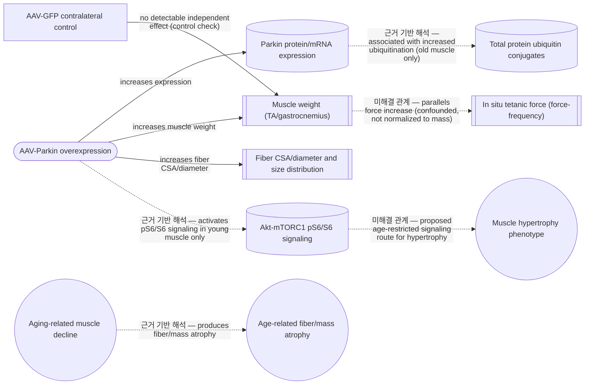
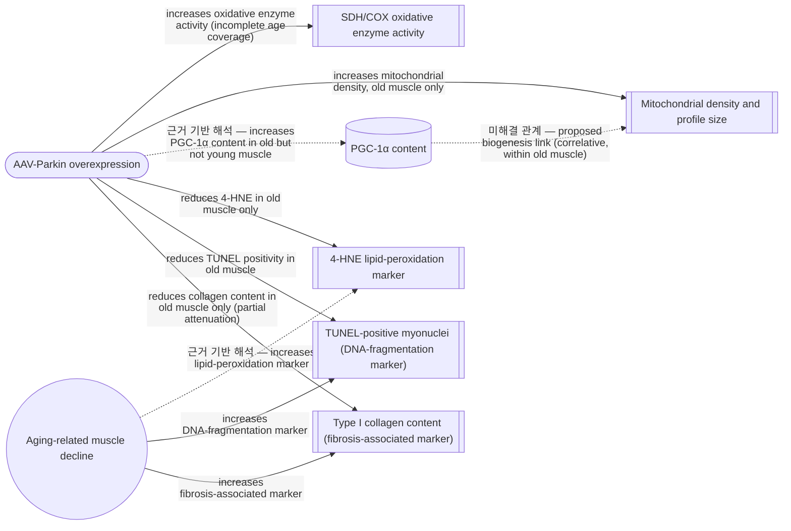

# Parkin overexpression protects from aging-related loss of muscle mass and strength

## Overview

### Executive Summary

이 연구는 골격근의 Parkin 발현을 높이면 노화에 따른 근육량, 근력 및 미토콘드리아 관련 표현형의 저하를 완화할 수 있는지 평가했다. 젊은 마우스와 노령 마우스의 한쪽 다리에 AAV-Parkin을, 반대쪽 다리에 AAV-GFP를 주입하여 각 동물이 자체 대조군이 되도록 했다. Parkin 과발현은 두 연령군에서 근육 무게와 기존 근섬유의 크기를 완만하게 증가시켰고, 별도의 노령 마우스 배치에서는 in situ 절대 수축력도 높였다.

노령 근육에서는 미토콘드리아 밀도와 PGC-1α content가 증가하고 4-HNE, TUNEL 양성 근핵 및 Type I collagen 지표가 감소했다. 그러나 근육량과 힘은 젊은 대조군 수준으로 완전히 회복되지 않았고, 직접적인 mitophagic flux, mitochondrial respiratory flux 또는 specific force는 측정되지 않았다. 따라서 방어 가능한 결론은 Parkin 과발현이 측정된 노화 표현형을 부분적으로 완화했다는 것이며, 노화를 역전시키거나 단일 mitophagy 기전을 입증했다는 것은 아니다.

### Research Question and Hypothesis

젊은 마우스와 노령 마우스의 골격근에서 Parkin을 국소적으로 과발현시키면 노화에 따른 근육량·근력 저하와 미토콘드리아 관련 이상을 방지하거나 완화할 수 있는가? 연구의 작업 가설은 Parkin 증가가 mitochondrial quality control과 연관된 근육 보호 효과를 제공할 것이라는 것이지만, 실험은 Parkin 과발현 효과를 검증하도록 설계되었을 뿐 mitophagy 증가가 그 효과의 필수 원인인지를 직접 검정하지는 않았다.

## Background

### Context at Publication

발표 당시 sarcopenia는 근육량과 근력 저하뿐 아니라 미토콘드리아 에너지대사 이상, 산화적 손상 및 세포사멸 민감성 증가와 연관된 다인성 현상으로 이해되고 있었다. Parkin은 미토콘드리아 단백질 ubiquitination과 손상된 미토콘드리아의 선택적 제거에 관여하는 E3 ubiquitin ligase로 알려져 있었고, Parkin 결핍 연구는 골격근의 수축 및 미토콘드리아 기능에서 Parkin의 생리적 역할을 뒷받침했다(Chen et al., 2018).

그러나 골격근의 mitochondrial quality control을 정준 PINK1–Parkin 경로 하나로 설명할 수는 없었다. 운동 및 골격근 연구에서는 AMPK–ULK1 신호, receptor-mediated mitophagy와 다른 ubiquitin ligase가 대안적 또는 병행 경로로 제시되었고, PINK1 안정화 없이도 운동 유발 mitophagy가 관찰되었다(Chen et al., 2018; Drake et al., 2019). 따라서 Parkin 발현 증가나 미토콘드리아 함량 증가는 그 자체로 선택적 mitophagic flux 증가를 의미하지 않는다.

핵심적인 미해결점은 노화된 포유류 골격근에서 Parkin을 직접 증가시키는 gain-of-function 개입이 근육량·힘과 미토콘드리아 관련 표현형을 실제로 보존할 수 있는가였다. 기존 근거는 knockout, 운동 또는 관찰적 노화 연구에 주로 의존했기 때문에, 이 연구는 sarcopenia가 나타나기 전 국소 Parkin 과발현을 시작하여 그 공백을 시험한 proof-of-principle 연구로 자리매김했다.

### Current Research Context

후속 연구는 Parkin 과발현의 보호 효과가 노화 이외의 근육 소모 상황에도 나타날 수 있음을 보여주었다. 패혈증 유발 근육 소모 모델에서는 AAV-Parkin이 근섬유 위축과 일부 미토콘드리아 이상을 완화했지만 직접적인 mitophagic flux나 수축력은 측정하지 않았다(Leduc-Gaudet et al., 2020). 정상 식이에서는 근육량과 최대 호흡능력 등에 이점이 관찰된 반면 고지방 식이에서는 미토콘드리아 기능 개선이 나타나지 않아, 효과가 대사적 맥락에 의존할 가능성도 제기되었다(Reynaud et al., 2023).

최근의 종합적 해석은 Parkin이 mitophagy뿐 아니라 mitochondrial dynamics, 단백질 turnover 및 PGC-1α 관련 신호를 통해 건강한 노화에 기여할 수 있다고 본다. 동시에 Parkin 발현량과 실제 mitochondrial turnover가 어떻게 대응하는지는 여전히 불확실하다(Leduc-Gaudet et al., 2022; Triolo & Hood, 2022). Duchenne muscular dystrophy 모델에서도 근육량과 일부 bioenergetic 지표는 개선되었지만 최대 호흡능력, 미토콘드리아 함량 및 주요 조직학적 특징은 함께 개선되지 않아, Parkin의 효과가 모든 질환과 측정 항목에 균일하지 않음이 확인되었다(Reynaud et al., 2026).

## Concepts

### Parkin and skeletal-muscle mitochondrial quality control

Parkin은 ubiquitin을 기질 단백질에 연결하는 E3 ubiquitin ligase이며 PINK1–Parkin mitophagy 경로의 중심 구성요소이다. Mitophagy는 손상된 미토콘드리아의 selective autophagic turnover를 뜻한다. 다만 이 연구가 직접 확인한 것은 Parkin mRNA·단백질과 전체 ubiquitin conjugates의 증가이지, 미토콘드리아 기질 특이적 ubiquitination이나 autophagosome–lysosome flux가 아니다.

Sarcopenia는 다요인성 임상 구성개념이다. 이 연구의 근육 습중량과 laminin-defined fiber size는 기존 근섬유의 비대와 일치하지만 새로운 근섬유 형성인 hyperplasia를 보여주지는 않는다. PGC-1α, SDH/COX 조직화학, 4-HNE, TUNEL 및 Type I collagen 역시 각각 mitochondrial biogenesis 관련 신호, 효소 관련 활성, 지질과산화, DNA fragmentation 및 결합조직 침착의 지표로서 의미가 있으며, 해당 생물학적 과정 전체를 직접 측정한 것으로 확대해서는 안 된다.

## Study Design and Methods

### Overall Study Design

연구진은 젊은 코호트에서는 3개월령에 개입을 시작해 7개월령에 평가했고, 노령 코호트에서는 18개월령에 시작해 22개월령에 평가했다. 각 마우스의 우측 TA와 gastrocnemius에는 AAV1-MCK-Parkin-GFP를, 반대쪽 근육에는 같은 MCK promoter를 사용하는 AAV1-GFP를 주입했다. 두 차례의 국소 투여 후 총 4개월 동안 발현시킨 contralateral-leg design으로, 각 동물이 자체 대조군이 되게 하여 전신 상태와 개체 간 변이를 통제했다.

주된 분석 단위는 동일 개체 안의 AAV-Parkin 근육과 AAV-GFP 근육의 차이였다. 발현 검증, 근육 무게와 섬유 크기, 신호전달 및 조직학적 지표는 주요 코호트에서 평가했지만, in situ 수축력은 형태학적 분석과 별도의 노령 마우스 배치에서만 측정했다. 이 구분은 형태 변화와 기능 변화를 동일 동물에서 직접 연결할 수 없다는 해석 경계를 만든다.

### Experimental Logic

실험은 먼저 AAV가 골격근을 형질도입하고 목표한 Parkin 발현을 높였는지 확인한 뒤, 그 조작이 근육 무게와 기존 근섬유 크기에 미치는 영향을 비교하도록 구성되었다. 다음으로 별도 노령 코호트의 직접 근육 자극을 통해 형태학적 차이가 절대 힘 생성과 연결되는지 평가하고, pS6/S6 측정으로 두 연령에서 공통된 mTORC1 관련 설명이 가능한지도 조사했다.

이후 SDH·COX 조직화학, TEM 및 PGC-1α 면역표지를 통해 미토콘드리아 관련 적응을 서로 다른 수준에서 조사하고, 4-HNE, TUNEL 및 Type I collagen을 이용해 산화적 손상, 근핵 세포사멸 및 세포외기질 변화가 동반되는지 평가했다. 이러한 측정 사슬은 Parkin 과발현과 여러 보호적 표현형의 연관성을 검토하지만, 각 지표 사이의 인과 순서나 단일한 mitophagy 매개 기전을 직접 입증하도록 설계되지는 않았다.

> 도형은 intervention/control·method/measurement·biological entity·observed phenotype의 역할을 구분한다. 실선은 직접 결과, 점선은 근거 기반 해석·외부 맥락·미해결 관계를 뜻한다.

#### Parkin intervention validation and muscle phenotype

#### Mitochondrial and aging-associated marker evidence

### Main Experiments and Methods

AAV 전달과 발현은 GFP 양성 근섬유, Parkin 면역블롯 및 Park2 qPCR로 확인했고, 노령 근육에서는 전체 ubiquitin conjugates도 측정했다. GFP는 형질도입 위치를, 면역블롯과 qPCR은 각각 단백질 및 전사체 수준의 발현을 평가한다. 그러나 전체 ubiquitination은 Parkin 특이 기질이나 미토콘드리아 기질을 구분하지 않으며, 이 측정만으로 선택적 mitophagy를 확인할 수 없다.

근육 표현형은 TA와 gastrocnemius 습중량, laminin으로 구획한 섬유 단면적·최소 Feret 직경·크기 분포로 평가했다. 노령 마우스의 기능 평가는 혈류를 유지한 상태에서 TA를 직접 자극해 force–frequency curve를 얻는 in situ 방법을 사용했다. 직접 자극은 중추신경계 기여를 줄이지만, 보고된 힘은 근육량이나 생리학적 단면적으로 정규화되지 않은 절대값이므로 specific force를 나타내지 않는다.

미토콘드리아 관련 측정에는 complex II와 IV 활성의 반정량적 조직화학 대리지표인 SDH 및 COX 염색, 노령 white gastrocnemius의 2차원 미토콘드리아 면적 분율과 단면적을 측정하는 TEM, mitochondrial biogenesis 관련 신호인 PGC-1α 면역표지가 사용되었다. COX는 젊은 근육에서만, TEM은 노령 근육에서만 평가되었으며 어느 방법도 mitochondrial respiratory flux나 mitophagic flux를 직접 측정하지 않는다.

노화 관련 손상 표현형은 4-HNE 면역표지·면역블롯, TUNEL과 dystrophin/DAPI의 결합 표지, Type I collagen 면역염색으로 평가했다. 이 방법들은 각각 지질과산화 관련 변형, DNA 절편화를 보이는 근핵, 조직 단면의 collagen 신호를 정량하지만 ROS 생성률, 세포사멸의 전체 경로 또는 총 섬유화량을 직접 측정하지는 않는다.

## Results

### Major Findings

AAV-Parkin을 주입한 근육에서는 거의 모든 근섬유가 GFP 양성을 보였고, 젊은 마우스와 노령 마우스 모두에서 대측 AAV-GFP 근육보다 Parkin mRNA와 단백질이 증가했다. 노령 근육에서는 전체 ubiquitin conjugates도 증가했다. 이 결과는 조작과 발현이 성립했음을 뒷받침하지만, 전체 ubiquitination은 Parkin 특이적 기질이나 mitophagic flux를 식별하지 않는다.

노령 대조 근육은 젊은 대조 근육보다 질량이 낮았으며, Parkin 과발현은 두 연령군 모두에서 TA와 gastrocnemius 무게 및 평균 근섬유 크기·직경을 약 8–11% 증가시키고 크기 분포를 큰 섬유 쪽으로 이동시켰다. 별도의 노령 마우스 배치에서는 시험한 모든 자극 빈도에서 AAV-Parkin TA의 절대 힘이 대측 AAV-GFP TA보다 높았다. 다만 힘은 근육 크기로 정규화되지 않았고 노령 Parkin 근육의 질량과 힘은 젊은 대조 수준으로 완전히 회복되지 않았다.

pS6/S6는 젊은 근육에서만 Parkin 과발현 후 증가했고 노령 근육에서는 일관되게 변하지 않았다. 따라서 두 연령군에서 관찰된 근섬유 확대가 종말점에서 동일한 mTORC1 관련 신호 변화를 동반하지는 않았다. 이는 측정된 차이를 기술하지만, 일시적인 신호 변화나 다른 단백질 turnover 경로의 관여 여부는 결정하지 못한다.

Parkin 과발현은 두 연령군에서 SDH 조직화학적 활성을 증가시켰고, 젊은 근육에서는 COX 활성도 증가시켰다. 노령 근육에서는 TEM 기반 미토콘드리아 면적 밀도가 72% 증가하는 동시에 개별 미토콘드리아 평균 단면적이 감소했으며, PGC-1α 면역표지 신호도 증가했다. 그러나 COX와 TEM이 서로 다른 연령군에서만 측정되었고 TEM은 2차원 단면 분석이므로, 이 결과들을 모든 연령에 공통된 미토콘드리아 증량 또는 생합성 flux로 통합할 수는 없다.

노령 대조 근육에서 증가한 4-HNE는 Parkin 과발현 후 감소했지만 젊은 근육에서는 변하지 않았다. 노령 근육의 TUNEL 양성 근핵 비율 역시 모든 대측 비교에서 감소했고, 노화에 따라 증가한 Type I collagen 신호도 노령 Parkin 근육에서 낮아졌다. 이 결과들은 해당 표지자들의 유리한 변화를 보여주지만 ROS 생성, 세포사멸의 원인 경로 또는 실제 총 collagen 침착량 감소를 각각 직접 입증하지는 않는다.

## Discussion

### Conclusion

Parkin의 안정적인 과발현과 함께 두 연령군에서 근육량·근섬유 크기가 증가했고, 노령 근육에서는 절대 수축력과 여러 미토콘드리아 및 조직 손상 지표가 유리하게 변했다. 이 결과들을 종합하면, 국소 Parkin 증가는 성체 근육에서 비대를 유도하고 노령 근육에서 노화 관련 질량·힘 손실과 일부 불리한 표현형을 부분적으로 완화할 수 있다는 연구 질문의 답을 제공한다.

그러나 변한 항목과 변하지 않은 항목은 구분해야 한다. 근육 크기는 두 연령에서 증가했지만 pS6/S6 증가는 젊은 근육에 한정되었고, PGC-1α 증가는 노령 근육에 한정되었다. 또한 근육량과 힘의 완전한 정상화, specific force 향상, 직접적인 호흡 기능 또는 mitophagic flux 증가는 입증되지 않았다. 따라서 관찰된 보호 효과를 하나의 PINK1–Parkin mitophagy 기전으로 확정하는 것은 측정 범위를 넘어선다.

### Significance

이 연구의 주요 기여는 노화 골격근에서 Parkin의 역할을 결핍이나 관찰적 연관성으로 추론하는 데 그치지 않고, sarcopenia가 나타나기 전 Parkin을 국소적으로 증가시키는 gain-of-function 개입으로 직접 시험했다는 점이다. 대측 근육 설계에서 발현, 형태, 기능 및 조직학적 지표가 일관되게 유리한 방향을 보였다는 결과는 Parkin을 노화 근육 연구의 개입 표적으로 검토할 근거를 제공한다.

그 의의는 임상적 유효성의 확립이 아니라 proof-of-principle에 있다. 수컷 마우스의 제한된 근육에 AAV를 주입한 결과이므로 인간 sarcopenia 치료, 전신 투여의 안전성 또는 장기 효과를 직접 뒷받침하지 않는다. 또한 SDH/COX, PGC-1α, 4-HNE, TUNEL 및 Type I collagen은 후속 연구의 유용한 readout이지만 직접적인 flux와 기능 측정으로 보완되어야 한다.

### Study Limitations

논문의 Discussion은 Parkin이 근육 비대, 산화적 손상 감소, 항세포사멸 효과 및 미토콘드리아 변화에 이르는 구체적 기전을 직접 조사하지 않았음을 남겨 두었다. 특히 젊은 근육과 노령 근육에서 서로 다른 신호 변화가 나타났고, Parkin–PARIS–PGC-1α, mitochondrial dynamics 및 항세포사멸 경로는 가능한 설명으로만 제안되었다. 따라서 저자들이 제시한 기전적 연결은 측정된 결과가 아니라 후속 검증이 필요한 해석이다.

### Critical Evaluation

가장 강한 설계적 장점은 동일 개체의 대측 다리를 비교하여 영양 상태, 호르몬, 신체활동과 같은 개체 수준 변이를 줄였다는 점이다. 발현 검증 후 근육 무게와 섬유 크기, 별도 기능 평가 및 여러 조직 지표를 연결한 것도 결론의 범위를 단일 대리 지표보다 넓혔다. 이에 따라 Parkin 과발현과 완만한 근육 비대 및 노령 근육의 여러 유리한 표현형 사이의 연관성은 비교적 일관되게 뒷받침된다.

반면 절대 힘 증가는 함께 증가한 근육 크기만으로도 설명될 수 있어 intrinsic contractile quality의 개선을 의미하지 않는다. 전체 ubiquitin conjugates는 Parkin 특이적 기질을 구분하지 않고, 4-HNE 감소는 ROS 생성 감소 외에 변형 단백질의 turnover 변화로도 생길 수 있다. Type I collagen 면역신호 감소도 섬유 비대에 따른 단위 면적당 희석 효과의 영향을 받을 수 있으므로, 각각의 결과를 E3 ligase 기전, 항산화 작용 또는 실제 섬유화 감소로 단정하기 어렵다.

노령 근육의 2차원 TEM 면적 밀도 증가와 개별 미토콘드리아 단면적 감소는 미토콘드리아 수 또는 총부피 증가뿐 아니라 fission–fusion 상태와 mitochondrial network morphology 변화로도 설명될 수 있다. 더구나 연령별로 측정된 미토콘드리아 지표가 달라 하나의 통합 기전을 구성하기 어렵다. 따라서 가장 신뢰할 수 있는 결론은 각 측정 항목의 방향성에 한정되며, 노화의 완전한 역전이나 mitophagy 중심의 인과 사슬은 입증되지 않았다.

### Future Directions

노화 골격근에서 PINK1–Parkin 동원, AMPK–ULK1 개시, mitochondrial fission, autophagosome–lysosome 전달 및 lysosomal degradation 가운데 어느 단계가 제한 요인인지 직접 검증해야 한다. Parkin 발현량이나 정적 표지자만으로는 개시와 완료를 구분할 수 없으므로, 직접적인 flux reporter와 시간 경과 측정이 필요하다(Chen et al., 2018; Triolo & Hood, 2022; Leduc-Gaudet et al., 2022).

Parkin의 효과가 성별, 근육 유형, 식이 및 질병 상태에 따라 유지되는지도 확인해야 한다. 노령 암컷, 다양한 골격근 및 인간 sarcopenia 코호트에서 mitochondrial respiratory flux, mitophagic flux, specific force와 전신 기능을 함께 평가해야 하며, 고지방 식이와 근이영양증에서 나타난 비균일한 반응은 이러한 맥락 검증의 필요성을 강조한다(Reynaud et al., 2023; Reynaud et al., 2026).

또 다른 질문은 골격근에서 Parkin을 선택적으로 증가시키면서 다른 장기의 노출과 전신 안전성 위험을 최소화할 수 있는가이다. 이 연구의 국소 근육내 전달은 해당 근육에서의 proof-of-principle에는 적합했지만 다른 조직의 발현, 장기 독성 및 전신 투여 결과를 시험하지 않았다. 따라서 치료 전략으로 확장하기 전에 표적 선택성, 지속 기간, 용량 의존성 및 장기 안전성을 검증해야 한다.

## References

- Chen CCW, Erlich AT, Crilly MJ, Hood DA. Parkin is required for exercise-induced mitophagy in muscle: impact of aging. American Journal of Physiology-Endocrinology and Metabolism. 2018;315(3):E404-E415. DOI: 10.1152/ajpendo.00391.2017.
- Drake JC, Laker RC, Wilson RJ, Zhang M, Yan Z. Exercise-induced mitophagy in skeletal muscle occurs in the absence of stabilization of Pink1 on mitochondria. Cell Cycle. 2019;18(1):1-6. DOI: 10.1080/15384101.2018.1559556.
- Triolo M, Hood DA. The importance of mitochondrial quality control for maintaining skeletal muscle function across health span. American Journal of Physiology-Cell Physiology. 2022;322(3):C461-C476. DOI: 10.1152/ajpcell.00388.2021.
- Leduc-Gaudet JP, et al. Parkin overexpression attenuates sepsis-induced muscle wasting. Cells. 2020;9(6):1454. DOI: 10.3390/cells9061454.
- Reynaud O, et al. The impact of high-fat feeding and parkin overexpression on skeletal muscle mass, mitochondrial respiration, and H2O2 emission. American Journal of Physiology-Cell Physiology. 2023;324(2):C366-C376. DOI: 10.1152/ajpcell.00388.2022.
- Leduc-Gaudet JP, Hussain SNA, Gouspillou G. Parkin: a potential target to promote healthy ageing. The Journal of Physiology. 2022;600(15):3405-3421. DOI: 10.1113/JP282567.
- Reynaud O, Ayoub MB, Leduc-Gaudet JP, et al. Parkin overexpression attenuates muscle atrophy and improves mitochondrial bioenergetics but not histological features of Duchenne muscular dystrophy in mice. Scientific Reports. 2026;16:4139. DOI: 10.1038/s41598-025-34223-9.
